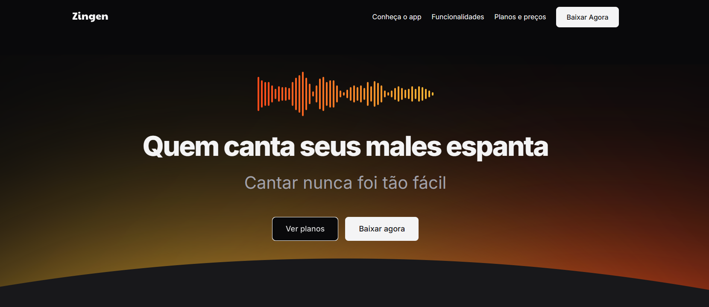

# Zingen - Karaokê

Uma landing page responsiva desenvolvida com **HTML5** e **CSS3** para o Zingen, um aplicativo de karaokê com inteligência artificial. A página apresenta o app, suas principais funcionalidades e os planos de assinatura.

## Tecnologias

- HTML5
- CSS3

## Funcionalidades

- Layout responsivo para mobile e desktop
- Estrutura semântica em HTML
- Organização do CSS em arquivos separados
- Menu de navegação com links para as seções

## Como executar

- Abra o arquivo `index.html` no navegador.
